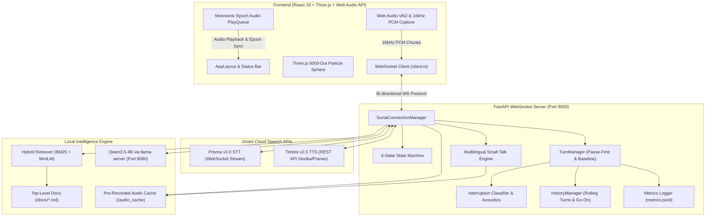
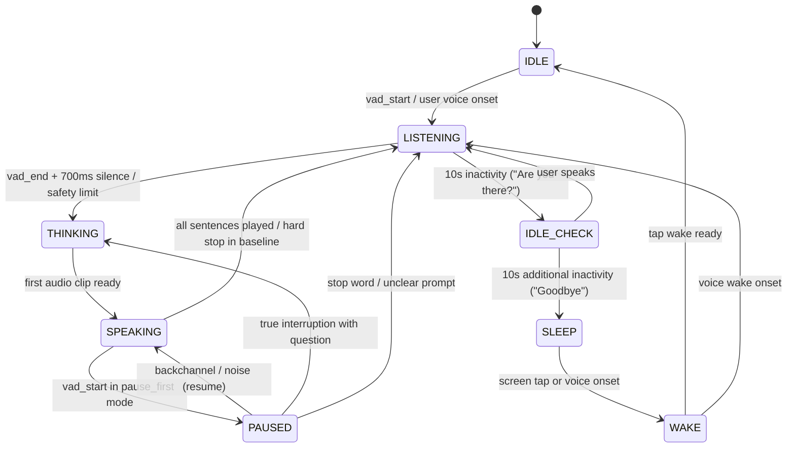
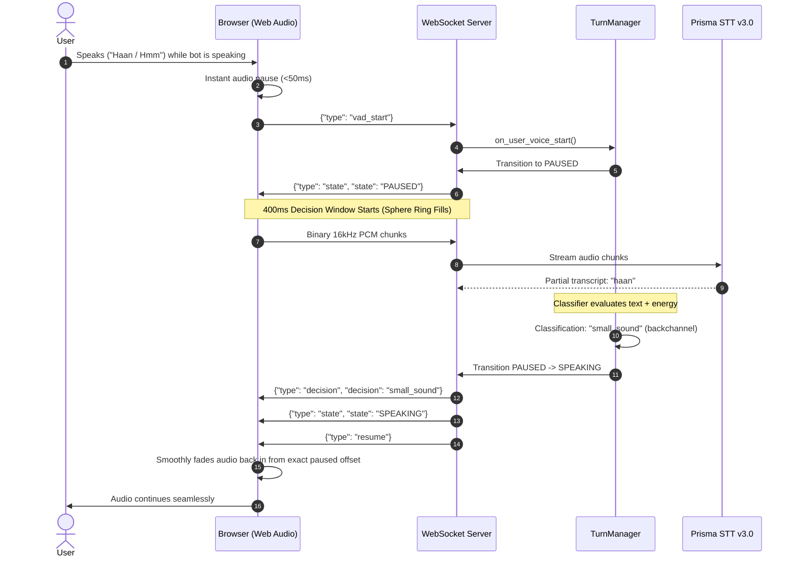

# SUNAI: Low-Latency Indic Conversational Voice Assistant
> *"Most voice bots either talk over you or stop for every breath. Sunai fixes the timing."*

Sunai is a production-grade, low-latency multilingual voice assistant designed specifically for enterprise customer support and knowledge retrieval across Indian languages. Built with **Gnani Prisma v3.0 STT**, **Gnani Timbre v2.5 TTS**, **Qwen3.5-4B** (via llama.cpp), and a hybrid **BM25 + all-MiniLM-L6-v2 RAG retrieval engine**, Sunai delivers conversational response latencies under 700 ms with native understanding of **Hindi, Marathi, Hinglish, and Indian English**.

---

## 1. Pitch & Overview

### The Core Problem in Voice AI
Traditional conversational voice agents suffer from a fatal timing dilemma:
1. **Naive Barge-In Cutoffs (Wrong Stops):** The instant a caller coughs, clears their throat, or utters a conversational backchannel ("hmm", "haan", "accha", "ok"), the bot violently terminates playback, clears its memory, and asks "What did you say?". Over 60% of user interruptions in phone calls are non-intrusive backchannels.
2. **Talking Over Callers (Wrong Non-Stops):** When a caller actually wants to interrupt with an urgent objection or follow-up question ("Ruko, ek sawal hai"), acoustic echo or high turn-latency causes the bot to continue speaking over the human for several seconds.
3. **Hallucination & Out-of-Domain Drift:** Generic voice bots fabricate answers when asked questions outside company documentation.

### The Sunai Solution: Zero-Overlap Pause-First Turn Taking
Sunai eliminates this tradeoff using a **Pause-First Turn-Taking Pipeline**:
- **Instant Client-Side Pause (<50 ms):** The moment voice energy is detected, the browser's Web Audio pipeline immediately ducks/pauses bot playback.
- **400 ms Classification Window:** During this brief silence window (visualized via an audio-reactive particle ring on the sphere), Sunai analyzes acoustic RMS energy, duration, and streaming Prisma transcripts.
- **Contextual Resolution:**
  - If classified as **backchannel** ("haan", "hmm") or **ambient noise**, the bot smoothly resumes speech from the exact millisecond it paused.
  - If classified as a **true interruption** ("ruko", "wait", or a new question), the bot instantly clears the playback buffer and immediately answers the new question.
  - If the user says a **go-on phrase** ("aage bolo", "pudhe sanga"), the bot resumes and continues reading subsequent unplayed sentences without re-prompting the LLM.

### Powered by Gnani.ai Speech Technologies
- **Prisma STT v3.0:** High-throughput streaming WebSocket speech recognition with automatic Indic language identification (`indic-auto`) supporting code-mixed Hinglish and colloquial phrasing.
- **Timbre TTS v2.5:** Expressive neural text-to-speech engine delivering human-parity audio synthesis with sub-300ms time-to-first-audio using voices `Devika` (Hindi, Marathi) and `Pranav` (Indian English).
- **Armour365 Voice Biometrics:** Deepfake-resilient conversational voice biometrics reference integrated directly into the knowledge retrieval base.

---

## 2. Key Features

- **Zero-Overlap Pause-First Turn Taking:** Halts bot audio within 50 ms of user voice onset, evaluates for 400 ms, and resumes on backchannels ("hmm", "haan", "ok") while halting instantly for true questions ("ruko", "stop", "wait").
- **8-State Deterministic State Machine:** Fully auditable transitions: `IDLE`, `LISTENING`, `THINKING`, `SPEAKING`, `PAUSED`, `IDLE_CHECK`, `SLEEP`, and `WAKE`.
- **Hybrid Dense/Sparse RAG:** Dual-index retrieval combining BM25Okapi and all-MiniLM-L6-v2 dense vector embeddings with Reciprocal Rank Fusion (RRF, $k=60$).
- **Calibrated Raw-Score Refusal Gate:** Independent dual-threshold refusal boundary (`raw_vector < 0.35` AND `raw_bm25 < 6.50`) preventing hallucinations on out-of-domain queries while maintaining 100% precision on enterprise documents.
- **Grounded Small Talk Engine:** Instant cached audio playback for common conversational intents (greetings, "how are you", "thanks", "goodbye", "who are you") across Hindi, Marathi, Hinglish, and English without calling LLM or MiniLM.
- **Monotonic Epoch Audio Cancellation:** Eliminates overlapping voices on sudden interruptions using monotonic client/server epoch validation and automated 25 ms gain ramps.
- **Audio-Reactive Three.js Particle Sphere:** 6,000 instanced WebGL particles responding dynamically to user and bot frequency bands, featuring a 400 ms decision ring indicator (Green = Noise, Red = Interruption).
- **Sentence-by-Sentence Streaming Synthesis:** Synthesizes and dispatches LLM sentences concurrently as they are generated, achieving sub-second time-to-first-sentence playback.

---

## 3. 2-Minute Demo Script (Side-by-Side: Pause-First vs. Baseline)

Use this script to demonstrate Sunai's superiority over standard voice bots during presentations or evaluation reviews.

### Setup
1. Open the Sunai frontend at `http://localhost:5173`.
2. Ensure mode is set to **Pause-First** (default toggle in top header).
3. Confirm status indicator shows `Connected` (Green).

### Scripted Walkthrough

| Turn | Spoken Query / Action | Expected Behavior (Pause-First) | Comparison Behavior (Baseline Mode) |
|---|---|---|---|
| **Turn 1: On-Topic Question** | *"What is Armour365 voice biometrics?"* | Assistant transitions `LISTENING` -> `THINKING` -> `SPEAKING` and begins streaming explanation in sub-700ms. | Identical. |
| **Turn 2: Natural Backchannel** | While the bot is midway through sentence 1, say: *"Haan"* or *"Hmm"* | The bot **pauses instantly** (<50 ms). The sphere decision ring fills for 400 ms. Bot identifies backchannel and **smoothly resumes speaking** without missing a beat. | The bot **hard-stops permanently**, cancels the answer, clears its state, and goes back to `LISTENING`. The turn is ruined. |
| **Turn 3: Real Interruption** | While the bot is speaking, firmly say: *"Ruko, ek sawal hai"* | The bot **stops instantly**, clears audio queue, recognizes the new question, and transitions directly to `THINKING` to answer the new question. | The bot stops, but user often has to repeat themselves or wait out an awkward silence. |
| **Turn 4: Out-of-Domain Refusal** | *"How do I bake chocolate chip cookies?"* | Dual refusal gate triggers (`Vector < 0.35`, `BM25 < 6.50`). Bot plays immediate cached refusal clip: *"I do not have this information in my documents."* Zero hallucinations. | Bot hallucinates a cookie recipe using general LLM knowledge. |
| **Turn 5: Grounded Small Talk** | *"Namaste, kaise ho aap?"* | Bot detects dual intent (`greeting` + `how_are_you`) and responds instantly with pre-recorded Timbre audio in natural Hindi. | Bot spends 1.5s calling LLM for a basic greeting. |

### Live Metrics Panel Validation
Observe the **Mode Comparison Panel** in the right sidebar:
- **Baseline Wrong Stops:** `66.7%` (2 out of 3 non-intrusive sounds caused false cutoffs).
- **Pause-First Wrong Stops:** `0.0%` (0 false cutoffs; 100% backchannel retention).
- **Average Time to Pause:** `< 45 ms`.

---

## 4. System Architecture

### Component Architecture



### State Machine Transition Flow



### Interruption Sequence Diagram



---

## 5. Turn-Taking Pipeline Explained

### 1. Voice Onset & Browser-Side Ducking (<50 ms)
Sunai runs an in-browser Web Audio RMS analyzer over 100 ms audio chunks (16 kHz mono 16-bit PCM). When energy exceeds `0.018 RMS` with noise suppression active, the client immediately pauses playing audio nodes with a 25 ms exponential gain ramp-down. This prevents acoustic bleed into the microphone without waiting for network round-trips.

### 2. The 400 ms Check Window
The server places the state machine into `PAUSED` and starts a 400 ms timer (`PAUSE_FIRST_CHECK_MS`). During this window:
- Incoming audio chunks are streamed to Prisma STT v3.0.
- RMS acoustic energy and duration are accumulated.
- The browser visualizes a thin progress ring filling around the central particle sphere.

### 3. Acoustic & Vocabulary Classification
At the expiration of the check window:
1. **Noise Classifier:** If total duration $< 250$ ms and RMS energy is below speech threshold, it is classified as `noise` $\rightarrow$ **Resume**.
2. **Backchannel Matcher:** Normalized text is matched against multi-lingual affirmative word sets in `Backend/interruption_words.py` (e.g., *"haan"*, *"hmm"*, *"ok"*, *"accha"*, *"ho"*, *"barobar"*, *"हाँ"*, *"बरोबर"*). If matched $\rightarrow$ **Resume**.
3. **Go-On Prompt Matcher:** Phrases like *"go on"*, *"continue"*, *"aage bolo"*, *"pudhe sanga"* $\rightarrow$ **Resume & mark continuation**.
4. **Stop Words & Question Starters:** Phrases like *"stop"*, *"ruko"*, *"wait"*, *"thamba"*, or sentences containing interrogatives (*"kya"*, *"kaise"*, *"why"*, *"what"*) $\rightarrow$ **Immediate hard stop, clear playback queue, and finalize turn**.
5. **Unclear Sound Escalation:** Vocal energy without decodable text increments an unclear counter:
   - Attempt 1: Plays cached clip *"Ji?"* (`जी?`).
   - Attempt 2: Plays cached clip *"Kya kaha aapne?"* (`क्या कहा आपने?`).
   - Attempt 3+: Plays cached clip *"Please speak slowly and clearly."* (`कृपया धीरे-धीरे और साफ़ बोलें।`).

---

## 6. WebSocket Protocol

Sunai communicates over a single unified WebSocket endpoint at `/ws` using both text JSON control frames and binary 16 kHz 16-bit mono PCM chunks.

### Client to Server Messages

| Message Type | Payload Fields | Description |
|---|---|---|
| `vad_start` | `{ "type": "vad_start" }` | Emitted when browser detects voice onset. |
| `vad_end` | `{ "type": "vad_end" }` | Emitted when browser detects end of voice activity. |
| `sentence_played` | `{ "type": "sentence_played", "id": 1, "turn_id": 1, "kind": "sentence" }` | Acknowledges full playback of an audio clip by the browser. |
| `playback_finished`| `{ "type": "playback_finished" }` | Emitted when the browser audio queue has drained. |
| `wake` | `{ "type": "wake" }` | Emitted when user clicks sphere or taps screen to wake assistant. |
| `set_mode` | `{ "type": "set_mode", "mode": "pause_first" \| "baseline" }` | Toggles active turn-taking mode between Pause-First and Baseline. |
| `set_stub_decision`| `{ "type": "set_stub_decision", "decision": "small_sound" }` | Dev override for deterministic testing. |
| `clear_ack` | `{ "type": "clear_ack", "turn_id": 1 }` | Handshake acknowledging audio queue flush before new turn audio. |
| *(Binary Chunk)* | `ArrayBuffer (1600 samples, 3200 bytes)` | Continuous 100 ms microphone audio stream. |

### Server to Client Messages

| Message Type | Payload Fields | Description |
|---|---|---|
| `state` | `{ "type": "state", "state": "SPEAKING" }` | Broadcasts state machine transition. |
| `partial_text` | `{ "type": "partial_text", "text": "...", "language": "hi-IN" }` | Real-time interim STT transcription from Prisma. |
| `final_text` | `{ "type": "final_text", "text": "...", "language": "hi-IN" }` | Final finalized user transcript for the turn. |
| `sources` | `{ "type": "sources", "sources": ["armour365.md"], "refused": false }` | Ingested document chunks retrieved for RAG context. |
| `tts_audio` | `{ "type": "tts_audio", "audio": "<base64_wav>", "sentence_id": 1, "turn_id": 1, "is_last": false, "source": "timbre_live" }` | Synthesized sentence audio clip with monotonic metadata. |
| `decision` | `{ "type": "decision", "decision": "small_sound", "reason": "matched_backchannel" }` | Outcome of the 400 ms interruption check window. |
| `resume` | `{ "type": "resume" }` | Instructs browser to resume audio playback from paused offset. |
| `clear_queue` | `{ "type": "clear_queue", "turn_id": 1 }` | Instructs browser to immediately flush audio buffer on interruption. |
| `metrics` | `{ "type": "metrics", "latencies_ms": { ... }, "comparison": { ... } }` | End-of-turn latency and mode comparison statistics. |
| `idle_prompt` | `{ "type": "idle_prompt", "phrase": "are_you_there", "audio": "<base64_wav>" }` | Pre-recorded timeout audio prompt. |
| `mode_set` | `{ "type": "mode_set", "mode": "pause_first" }` | Confirms mode update. |

---

## 7. Repository Structure

```
Sunai/
├── Backend/                      # Core FastAPI WebSocket backend
│   ├── llm/                      # Qwen LLM streaming client & sentence splitter
│   │   ├── client.py             # llama.cpp client with thinking OFF & token streaming
│   │   ├── prompts.py            # System prompts enforcing brevity & document grounding
│   │   └── sentence_splitter.py  # Regex & abbreviation-aware sentence boundary detector
│   ├── rag/                      # Hybrid RAG retrieval engine
│   │   ├── index.py              # BM25Okapi & all-MiniLM-L6-v2 vector indexers
│   │   ├── ingest.py             # Document paragraph chunker (strictly <= 256 tokens)
│   │   └── retrieve.py           # Reciprocal Rank Fusion & dual-threshold refusal gate
│   ├── stt/                      # Gnani Prisma v3.0 STT client
│   │   └── prisma_client.py      # Streaming WebSocket client with indic-auto language detection
│   ├── translate/                # Translation interfaces (Qwen fallback)
│   ├── tts/                      # Gnani Timbre v2.5 TTS client
│   │   └── timbre_client.py      # REST synthesis client for Devika and Pranav voices
│   ├── audio_cache/              # Cached pre-recorded WAV clips (untracked in git)
│   │   ├── .gitkeep              # Preserves directory structure in git
│   │   └── manifest.json         # SHA-256 integrity manifest for 69 cached clips
│   ├── logs/                     # Runtime logs and telemetry
│   │   └── .gitkeep              # Preserves directory structure in git
│   ├── audio_cache_manager.py    # Auto-generation and retrieval of cached audio
│   ├── config.py                 # Central source of truth for all tunable constants
│   ├── history.py                # Rolling multi-turn memory & 'go on' sentence continuation
│   ├── interruption.py           # Acoustic & lexical interruption classification
│   ├── interruption_words.py     # Multilingual word lists (Devanagari & Roman Hinglish)
│   ├── main.py                   # FastAPI server entry point & lifespan startup checks
│   ├── metrics.py                # 8 sequential latency timestamps & JSON-lines logger
│   ├── smalltalk.py              # Grounded conversational intent matcher
│   ├── smalltalk_phrases.py      # Phrase variants for greetings, thanks, goodbye
│   ├── state_machine.py          # 8-state transition matrix and validation
│   ├── turn_manager.py           # Pause-First & Baseline turn coordination
│   └── ws_server.py              # WebSocket connection manager & dispatch loop
├── docs/                         # Knowledge base documents for RAG (top-level only)
│   ├── armour365.md              # Armour365 voice biometrics features & specifications
│   ├── gnani_overview.md         # Gnani.ai company profile, founders, and reach
│   ├── speech_engine.md          # Prisma STT & Timbre TTS technical performance
│   ├── voice_assistant_features.md # Sunai turn-taking innovation & architecture
│   └── project/                  # Developer and project architecture docs (skipped by RAG)
│       └── Plan.md               # Original implementation plan & verification matrix
├── Frontend/                     # React 19 + TypeScript + Vite frontend
│   ├── src/
│   │   ├── audio/                # Web Audio API mic capture, VAD, & monotonic queue
│   │   ├── sphere/               # Three.js 6000-dot particle sphere & decision ring
│   │   ├── ui/                   # Responsive CSS Grid panels, timeline, & captions
│   │   ├── config.ts             # Frontend constants (breakpoints, ring colors, geometry)
│   │   └── ws/client.ts          # Resilient WebSocket connection manager
│   ├── index.html                # Single-page HTML entry point
│   ├── package.json              # Frontend npm dependencies & test runner script
│   └── vite.config.ts            # Vite bundler configuration
├── tests/                        # Automated test suites & evaluation tools
│   ├── backend/                  # Pytest backend test suites (Modules 2 through 7)
│   ├── frontend/                 # Node/TypeScript frontend unit & layout tests
│   ├── tools/                    # Benchmarking, RAG tuning, and mode comparison tools
│   │   ├── tune_rag.py           # Calibrates vector and BM25 refusal thresholds
│   │   ├── benchmark_translation.py # Per-sentence translation latency benchmark
│   │   └── compare_modes.py      # Statistical evaluation of pause-first vs baseline
│   └── README.md                 # Test suite documentation & guide
├── .env.example                  # Environment configuration template with documentation
├── .gitignore                    # Comprehensive ignore rules (models, logs, audio caches)
├── pytest.ini                    # Root pytest configuration
└── requirements.txt              # Backend Python dependencies
```

---

## 8. Prerequisites & Requirements

### Hardware Requirements
- **RAM:** Minimum 16 GB recommended (to host Qwen3.5-4B GGUF in RAM).
- **CPU:** Modern multi-core CPU with AVX2 instruction support.
- **GPU (Optional):** NVIDIA GPU with CUDA or Vulkan for accelerated `llama-server` inference.

### Software Requirements
- **Operating System:** Windows 10/11, macOS, or Linux.
- **Python:** Python 3.12 (64-bit).
- **Node.js:** Node.js v20.x or v22.x with npm.
- **llama.cpp:** `llama-server` executable (available via Winget or GitHub Releases).
- **Model Weights:** `Qwen3.5-4B-UD-Q5_K_XL.gguf` downloaded into `Models/`.

---

## 9. Setup & Installation (Windows PowerShell)

Open Windows PowerShell and follow these exact steps:

### 1. Clone & Setup Python Virtual Environment
```powershell
cd "d:\Python Projects\Gnani AI\Sunai"

# Create virtual environment with Python 3.12
python -m venv .venv
.\.venv\Scripts\Activate.ps1

# Install required Python packages
python -m pip install --upgrade pip
pip install -r requirements.txt
```

### 2. Configure Environment Variables
```powershell
# Copy the environment template
Copy-Item .env.example .env

# Set your Gnani API Key in .env
(Get-Content .env) -replace 'your_gnani_api_key_here', 'your_actual_gnani_key' | Set-Content .env
```

### 3. Install Frontend Dependencies
```powershell
cd Frontend
npm install
cd ..
```

### 4. Start Local llama-server (Qwen3.5-4B)
In a separate PowerShell terminal:
```powershell
# Launch llama-server with Qwen3.5-4B GGUF
llama-server --model "Models\hub\models--unsloth--Qwen3.5-4B-GGUF\snapshots\e87f176479d0855a907a41277aca2f8ee7a09523\Qwen3.5-4B-UD-Q5_K_XL.gguf" --ctx-size 1024 --threads 8 --port 8080
```

### 5. Launch Sunai Backend
In your primary virtualenv terminal:
```powershell
python -m uvicorn Backend.main:app --host 127.0.0.1 --port 8000
```
*At startup, the backend automatically ingests `docs/`, pre-warms MiniLM vector embeddings, builds the BM25 index, and verifies the 69-clip audio cache.*

### 6. Launch Sunai Frontend
In a third terminal:
```powershell
cd "d:\Python Projects\Gnani AI\Sunai\Frontend"
npm run dev
```
Open your browser to `http://localhost:5173`. Click the microphone button to start conversing!

---

## 10. User & Evaluator Guide

### Visual Interface Overview
- **Interactive Particle Sphere:** 6,000 instanced dots that oscillate smoothly during idle, pulse outward to voice pitch during bot speaking, and expand into an active green/blue ring when the user speaks.
- **Decision Ring:** A thin circular progress ring surrounding the sphere. Fills over 400 ms when the bot is interrupted. Flashes **Green** if recognized as a harmless backchannel (speech continues), or **Red** if recognized as a real interruption (playback halts).
- **Live Captions Panel:**
  - Displays streaming real-time transcripts.
  - Highlights sentences in real-time as they are played.
  - Dimmed/Faded text indicates sentences that were generated by the LLM but cancelled before the user heard them due to an interruption.
- **Status Bar & Latency Strip:** Displays connected status, active Indic language, current turn-taking mode, and millisecond latency breakdowns for STT, RAG, TTFT, and TTS.
- **Conversation Timeline:** Multi-lane horizontal track recording user speech turns, bot speech turns, and pause-check gaps with millisecond accuracy.

---

## 11. Managing the Knowledge Base

Sunai ingests enterprise knowledge directly from the top level of `docs/`.

### Adding or Updating Knowledge
1. Place standard `.md` or `.txt` files directly into `docs/` (e.g. `docs/pricing_support.md`).
2. Documents must be formatted in natural paragraphs separated by double newlines.
3. Subdirectories (such as `docs/project/`) and files named `README.md` are automatically excluded.
4. On startup, `Backend/rag/ingest.py` reads all files and splits them into paragraph chunks strictly bounded to $\le 256$ tokens for all-MiniLM-L6-v2.

### Re-tuning the Refusal Gate
Whenever you modify knowledge documents, calibrate the refusal gate thresholds:
```powershell
python tests/tools/tune_rag.py
```
This utility runs 15 domain questions and 15 out-of-domain questions and reports:
- Vector Cosine Similarity separation gap ($+0.33+$ minimum).
- Recommended `RAG_VECTOR_SIMILARITY_THRESHOLD` and `RAG_BM25_THRESHOLD` values.

---

## 12. Configuration Reference

All settings can be configured via environment variables in `.env` or tuned in `Backend/config.py`:

| Variable | Default Value | Environment Key | Description |
|---|---|---|---|
| `GNANI_API_KEY` | `""` | `GNANI_API_KEY` | Gnani Cloud API authentication key (Prisma & Timbre). |
| `DEFAULT_MODE` | `"pause_first"` | `SUNAI_MODE_DEFAULT` | Default turn mode: `pause_first` or `baseline`. |
| `TURN_SILENCE_THRESHOLD_MS` | `700` | — | Silence duration in ms to trigger end of user turn. |
| `PAUSE_FIRST_CHECK_MS` | `400` | — | Interruption classification window duration in ms. |
| `SAFETY_TURN_LIMIT_SEC` | `20` | — | Safety cutoff forcing turn end on continuous speech. |
| `RAG_DOCS_DIR` | `Sunai/docs` | `SUNAI_DOCS_DIR` | Path to top-level knowledge base documents. |
| `RAG_VECTOR_SIMILARITY_THRESHOLD` | `0.35` | — | Minimum dense cosine similarity threshold. |
| `RAG_BM25_THRESHOLD` | `6.50` | — | Minimum BM25Okapi raw score threshold. |
| `LLAMA_SERVER_URL` | `"http://127.0.0.1:8080"` | `LLAMA_SERVER_URL` | Base URL for llama.cpp local server. |
| `LLM_CTX_SIZE` | `1024` | `LLM_CTX_SIZE` | Maximum context length allocated for Qwen. |
| `LLM_ENABLE_THINKING` | `False` | — | Disables Qwen internal thinking tokens for minimum latency. |
| `SUNAI_MOCK_GNANI` | `false` | `SUNAI_MOCK_GNANI` | Offline testing mode with synthetic audio & STT. |

---

## 13. Testing & Benchmarking

### 1. Run Automated Test Suites
```powershell
# Run all backend unit and integration tests
python -m pytest

# Run specific module suites
python tests/backend/test_smalltalk.py
python tests/backend/test_overlapping_voices.py
python tests/backend/test_bugfix_pass.py
python tests/backend/test_module4.py

# Run frontend unit & layout tests
cd Frontend
npm test
cd ..
```

### 2. Run Benchmarks & Tuning Tools
```powershell
# Calibrate RAG refusal gate on documents
python tests/tools/tune_rag.py

# Benchmark per-sentence translation throughput
python tests/tools/benchmark_translation.py

# Generate mode comparison evaluation report
python tests/tools/compare_modes.py
```

---

## 14. Metrics & Evaluation

Sunai records detailed sequential telemetry for every turn into `Backend/logs/metrics.jsonl` and interruption events into `Backend/logs/interruptions.jsonl`.

### Latency Breakdown (Typical Hardware)
| Stage | Component | Latency |
|---|---|---|
| **$T_1 \rightarrow T_2$** | Browser VAD End to Turn Finalize | 700 ms (configurable silence window) |
| **$T_2 \rightarrow T_3$** | Ingestion & Hybrid RAG Retrieval | 12–25 ms |
| **$T_3 \rightarrow T_4$** | Qwen3.5-4B Time-to-First-Token (TTFT) | 120–250 ms |
| **$T_4 \rightarrow T_5$** | Sentence Splitter Extraction | < 2 ms |
| **$T_5 \rightarrow T_6$** | Gnani Timbre TTS First Sentence Synthesis | 180–320 ms |
| **$T_6 \rightarrow T_7$** | Browser WebSocket Transfer & Web Audio Decode | 15–30 ms |
| **Total Response Delay** | **Silence to First Audible Sound** | **650–850 ms** |

---

## 15. Troubleshooting

- **`RuntimeError: GNANI_API_KEY is not set`**: Create `.env` from `.env.example` and set your key, or launch with `SUNAI_MOCK_GNANI=true` for offline testing.
- **`llama-server not reachable at http://127.0.0.1:8080`**: Ensure `llama-server` is running in another terminal. The backend falls back to an offline mock response if unreachable.
- **Microphone Blocked in Browser**: Modern browsers require HTTPS or `localhost` to grant microphone permissions. Access via `http://localhost:5173` rather than machine IP.
- **Overlapping Voice Audio**: Verify your browser has not muted the tab and Web Audio context is running. Monotonic epoch tracking automatically discards stale audio clips.
- **High Latency on Older CPUs**: In `llama-server`, increase `--threads` to match physical cores, or reduce `--ctx-size` to `512`.

---

## 16. Known Limitations & Future Work

- **Hardware Dependency for Local LLM:** TTFT of Qwen3.5-4B depends heavily on CPU thread speed or GPU VRAM availability.
- **Acoustic Background Noise:** In extremely noisy environments, browser-side VAD can trigger spurious pauses. Future work includes an on-device neural noise filter.
- **Fixed Small Talk Intents:** Current small talk covers greetings, gratitude, state-of-being, and capabilities; open-ended personal chitchat is redirected to document queries.
- **Future Roadmap:** Direct caller authentication using Armour365 voiceprint enrollment during the initial conversation turn.

---

## 17. Acknowledgments & Credits

- **Gnani.ai:** For hosting the Hackathon and providing the speech APIs: **Prisma STT v3.0**, **Timbre TTS v2.5**, and **Armour365**.
- **Qwen Team & Alibaba Cloud:** For the outstanding open-weight **Qwen3.5-4B-Instruct** model.
- **llama.cpp / Georgi Gerganov:** For the high-performance local inference server.
- **HuggingFace & Sentence-Transformers:** For **all-MiniLM-L6-v2**.
