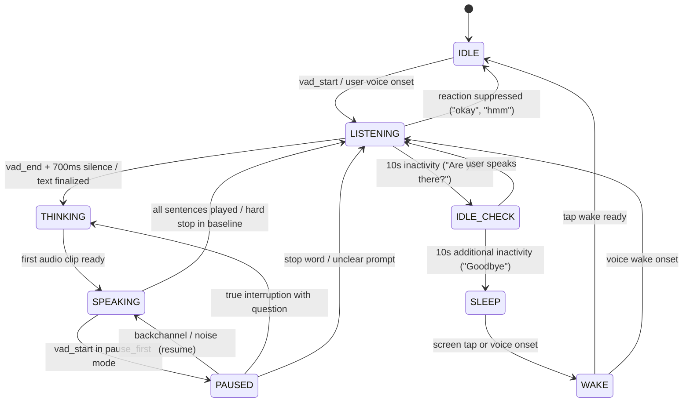
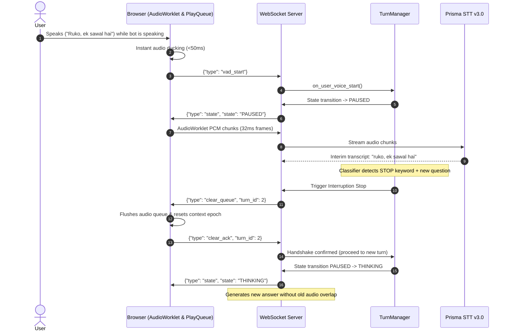

# SUNAI: Low-Latency Indic Conversational Voice Assistant
> *"Most voice bots either talk over you or stop for every breath. Sunai fixes the timing."*

Sunai is a production-grade, low-latency multilingual voice assistant designed specifically for enterprise customer support and knowledge retrieval across Indian languages. Built with **Gnani Prisma v3.0 STT**, **Gnani Timbre v2.5 TTS**, **Qwen3.5-4B** (via llama.cpp), an **AudioWorklet non-blocking mic capture pipeline**, and a hybrid **BM25 + all-MiniLM-L6-v2 RAG retrieval engine**, Sunai delivers conversational response latencies under 700 ms with native understanding of **Hindi, Marathi, Hinglish, and Indian English**.

---

## 1. Pitch & Overview

### The Core Problem in Voice AI
Traditional conversational voice agents suffer from four fatal timing and linguistic dilemmas:
1. **Naive Barge-In Cutoffs (Wrong Stops):** The instant a caller coughs, clears their throat, or utters a conversational backchannel (*"hmm"*, *"haan"*, *"accha"*, *"ok"*), standard voice bots violently terminate playback, wipe their context, and ask *"What did you say?"*. Over 60% of user vocalizations during bot speech in customer calls are non-intrusive backchannels.
2. **Talking Over Callers (Wrong Non-Stops & Audio Overlap):** When a caller genuinely interrupts with an urgent objection or follow-up (*"Ruko, ek sawal hai"*), latency and unmanaged playback queues cause the bot to continue blaring old audio over the user's new question, resulting in cacophonous audio collision.
3. **Indic Language Misidentification:** Streaming ASR engines operating on code-mixed or colloquial Indic speech frequently tag Marathi Devanagari speech as Hindi (`hi-IN`), causing the assistant to answer in the wrong language or route through incorrect translation pipelines.
4. **Hallucination & Out-of-Domain Drift:** Generic voice bots fabricate answers when asked queries outside corporate documentation.

### The Sunai Solution: Zero-Overlap Pause-First Turn Taking
Sunai completely eliminates these tradeoffs using an intelligent **Pause-First Turn-Taking Pipeline**:
- **Instant Client-Side Ducking (<50 ms):** The moment voice energy is detected, the browser's Web Audio pipeline immediately pauses bot playback with an exponential gain ramp.
- **Dynamic Decision Window with Prisma Text Wait:** Rather than giving up at an arbitrary cutoff while speech is ongoing, Sunai keeps the window open during active vocalization, waits up to 1.0 s after `vad_end` for Prisma STT's final transcript, and provides an immediate early exit (350 ms) as soon as real words are recognized.
- **Contextual Multilingual Resolution:**
  - If classified as a **backchannel** (*"haan"*, *"hmm"*, *"बरोबर"*) or **ambient noise**, the bot smoothly resumes speech from the exact millisecond it paused.
  - If classified as a **true interruption** (*"ruko"*, *"wait"*, or a new question), the bot halts playback, enforces a bidirectional `clear_ack` handshake to guarantee zero audio overlap, and answers the new question.
  - If the user says a **continuation phrase** (*"aage bolo"*, *"pudhe sanga"*), the bot resumes and continues reading subsequent unplayed sentences without re-querying the LLM.
  - If the bot is idle/listening and receives a short conversational reaction (*"okay"*, *"theek hai"*), **Reaction Suppression** returns the bot to resting state without triggering expensive RAG/LLM calls.
- **Reliable Marathi & Indic Language Hint System:**
  - **Auto Disambiguation:** 32 Devanagari function words (`MARATHI_MARKER_WORDS` and `HINDI_MARKER_WORDS`) automatically resolve `hi-IN` vs. `mr-IN` turns while keeping Prisma STT on `indic-auto`.
  - **Interactive Language Selector:** Segmented control (`Auto` / `हिन्दी` / `मराठी`) in the Intelligence panel with browser persistence and real-time WebSocket hint synchronization.

### Powered by Gnani.ai Speech Technologies
- **Prisma STT v3.0:** High-throughput streaming WebSocket speech recognition with automatic Indic language identification (`indic-auto`) supporting code-mixed Hinglish and colloquial phrasing.
- **Timbre TTS v2.5:** Expressive neural text-to-speech engine delivering human-parity audio synthesis with sub-300ms time-to-first-audio using voices `Devika` (Hindi, Marathi) and `Pranav` (Indian English).
- **Armour365 Voice Biometrics:** Deepfake-resilient conversational voice biometrics reference integrated directly into the knowledge retrieval base.

---

## 2. Key Features

- **Zero-Overlap Pause-First Turn Taking:** Halts bot audio within 50 ms of user voice onset, evaluates speech dynamically, and resumes on backchannels (*"hmm"*, *"haan"*, *"ok"*) while halting instantly for true questions (*"ruko"*, *"stop"*, *"wait"*).
- **Non-Blocking AudioWorklet Capture:** Off-main-thread 16 kHz 16-bit mono PCM capture via `worklet-processor.js` with zero GC allocations in `process()`, linear resampler fallback, and 32 ms chunk streaming.
- **Bidirectional Handshake (`clear_ack`):** Strict handshake protocol preventing audio overlap when an interrupted turn transitions into a newly asked question.
- **Reaction & Empty Go-On Suppression:** Silently absorbs post-answer reactions (*"okay"*, *"theek hai"*) without sending them to LLM/RAG or triggering false refusals.
- **Multilingual Hint Resolution (`language_hint.py`):** Resolves ambiguous Devanagari transcripts between Hindi and Marathi using high-confidence lexical markers and conversation history.
- **UI Language Selector:** Small segmented control (`Auto` / `हिन्दी` / `मराठी`) situated at the top of the Intelligence & Latency panel; remembers choice in `localStorage` and applies dynamically without restarting the STT stream.
- **8-State Deterministic State Machine:** Fully auditable transitions: `IDLE`, `LISTENING`, `THINKING`, `SPEAKING`, `PAUSED`, `IDLE_CHECK`, `SLEEP`, and `WAKE`.
- **Hybrid Dense/Sparse RAG:** Dual-index retrieval combining BM25Okapi and all-MiniLM-L6-v2 dense vector embeddings with Reciprocal Rank Fusion (RRF, $k=60$).
- **Calibrated Raw-Score Refusal Gate:** Independent dual-threshold refusal boundary (`raw_vector < 0.35` AND `raw_bm25 < 6.50`) preventing hallucinations on out-of-domain queries while maintaining 100% precision on enterprise documents.
- **Grounded Small Talk Engine:** Instant cached audio playback for common conversational intents (greetings, "how are you", "thanks", "goodbye", "who are you") across Hindi, Marathi, Hinglish, and English without calling LLM or MiniLM.
- **Sentence-by-Sentence Streaming Synthesis:** Synthesizes and dispatches LLM sentences concurrently as they are generated, achieving sub-second time-to-first-sentence playback.
- **Audio-Reactive Three.js Particle Sphere:** 6,000 instanced WebGL particles responding dynamically to user and bot frequency bands, featuring an interruption decision ring (Green = Resume, Red = Stop).

---

## 3. 2-Minute Demo Script (Side-by-Side: Pause-First vs. Baseline)

Use this script to demonstrate Sunai's superiority over standard voice bots during presentations or evaluation reviews.

### Setup
1. Open the Sunai frontend at `http://localhost:5173`.
2. Ensure mode is set to **Pause-First** (default toggle in top header).
3. Confirm status indicator shows `WS Connected` (Green).

### Scripted Walkthrough

| Turn | Spoken Query / Action | Expected Behavior (Pause-First) | Comparison Behavior (Baseline Mode) |
|---|---|---|---|
| **Turn 1: On-Topic Question** | *"What is Armour365 voice biometrics?"* | Assistant transitions `LISTENING` $\rightarrow$ `THINKING` $\rightarrow$ `SPEAKING` and begins streaming explanation in sub-700ms. | Identical. |
| **Turn 2: Natural Backchannel** | While the bot is midway through sentence 1, say: *"Haan"* or *"Hmm"* | The bot **pauses instantly** (<50 ms). The sphere decision ring fills. Bot identifies backchannel and **smoothly resumes speaking** without missing a beat. | The bot **hard-stops permanently**, cancels the answer, clears its state, and goes back to `LISTENING`. The turn is ruined. |
| **Turn 3: Interruption + New Question** | While the bot is speaking, firmly say: *"Ruko, ek sawal hai"* | The bot pauses, clears playback queue via `clear_ack` handshake, cancels previous turn, and transitions directly to `THINKING` to answer the new question with **zero audio overlap**. | The bot stops awkwardly, or worse, resumes previous sentence audio over the new answer. |
| **Turn 4: Marathi Language Hint** | Switch Language selector to **मराठी** and ask: *"तुम्ही काय करू शकता?"* | Turn language stays strictly **Marathi (`mr-IN`)**, translates to English for RAG, and translates answer back to Marathi for Timbre synthesis. | Without hint, Prisma may tag Devanagari as `hi-IN` and bot answers in Hindi. |
| **Turn 5: Post-Answer Reaction** | Once bot finishes speaking, say: *"Okay"* or *"Theek hai"* | **Reaction Suppression** triggers. State transitions cleanly to `IDLE`. No LLM call, no refusal clip played. | Bot treats *"Okay"* as a query, fails RAG, and speaks *"I do not have this information."* |
| **Turn 6: Out-of-Domain Refusal** | *"How do I bake chocolate chip cookies?"* | Dual refusal gate triggers (`Vector < 0.35`, `BM25 < 6.50`). Bot plays immediate cached refusal clip: *"I do not have this information in my documents."* Zero hallucinations. | Bot hallucinates a cookie recipe using general LLM knowledge. |

---

## 4. System Architecture

### Component Architecture

```mermaid
flowchart TD
    subgraph Client ["Client Presentation Layer (Browser)"]
        subgraph App ["Voice Assistant (Frontend - Port 5173)"]
            UI["AppLayout, Status Bar, & Intelligence Panel"]
            Sphere["Three.js 6000-Dot Particle Sphere"]
            Worklet["AudioWorklet Non-Blocking Capture (16kHz PCM)"]
            PlayQueue["Monotonic Epoch Audio PlayQueue (with clear_ack)"]
            WSClient["WebSocket Client (client.ts)"]
        end
        subgraph Deck ["Presentation Deck (Landing - Port 5174)"]
            Slides["16 Interactive Slides (GSAP + Lenis)"]
            HUD["HUD Controls & Autoplay Engine"]
            DemoPlayer["Slide 14 Lazy-Mounted Drive Video"]
            Mesh["3D Morphing WebGL Mesh"]
        end
    end

    subgraph Backend ["FastAPI WebSocket Server (Port 8000)"]
        WSHandler["SunaiConnectionManager"]
        SM["8-State State Machine"]
        TM["TurnManager (Pause-First & Baseline)"]
        Classifier["Interruption Classifier & Acoustics"]
        LangHint["Language Hint Resolver (Auto / hi-IN / mr-IN)"]
        History["HistoryManager (Rolling Turns & Go-On)"]
        Metrics["Metrics Logger (metrics.jsonl & interruptions.jsonl)"]
        SmallTalk["Multilingual Small Talk Engine"]
    end

    subgraph Speech ["Gnani Cloud Speech APIs"]
        Prisma["Prisma v3.0 STT (WebSocket indic-auto Stream)"]
        Timbre["Timbre v2.5 TTS (REST API Devika/Pranav)"]
    end

    subgraph AI ["Local Intelligence Engine"]
        Retriever["Hybrid Retriever (BM25 + MiniLM)"]
        Docs["Top-Level Docs (/docs/*.md)"]
        Qwen["Qwen3.5-4B via llama-server (Port 8080)"]
        Cache["Pre-Recorded Audio Cache (/audio_cache)"]
    end

    Worklet -->|16kHz 16-bit PCM (512-sample chunks)| WSClient
    WSClient <-->|Bi-directional WS Protocol & clear_ack| WSHandler
    WSHandler --> SM
    WSHandler --> TM
    WSHandler --> LangHint
    TM --> Classifier
    TM --> History
    TM --> Metrics
    WSHandler --> SmallTalk
    SmallTalk --> Cache
    WSHandler <--> Prisma
    WSHandler <--> Timbre
    WSHandler --> Retriever
    Retriever --> Docs
    WSHandler <--> Qwen
    WSHandler --> Cache
    PlayQueue -->|Audio Playback & Epoch Sync| UI
```

### State Machine Transition Flow



### Interruption & `clear_ack` Sequence Diagram



---

## 5. Turn-Taking Pipeline Explained

### 1. AudioWorklet Capture & Instant Ducking (<50 ms)
- Mic capture runs in an isolated Web Audio worklet (`Frontend/public/worklet-processor.js`).
- Blocks of 128 samples are accumulated into pre-allocated Int16 buffers without allocating memory inside `process()`.
- Chunks of 512 samples (32 ms, 1024 bytes at 16 kHz) are dispatched to the WebSocket. If the system audio context rate is not 16 kHz, an inline linear resampler converts the audio before transmission.
- When browser-side VAD detects vocal energy during assistant playback, it immediately pauses the active audio node with a 25 ms exponential gain ramp.

### 2. The Dynamic Barge-In Decision Window
When voice begins during assistant speech, the server enters `PAUSED`:
1. **Dynamic Speech Hold:** If the caller continues speaking, the window stays open rather than timing out at 500 ms.
2. **Early Lexical Exit:** If Prisma returns decodable text with at least 1 word after the minimum check time (350 ms), the classifier evaluates immediately without waiting for the caller to finish.
3. **Post-Voice Wait:** Once `vad_end` is received, the server waits up to `PAUSE_POST_VOICE_TEXT_WAIT_SEC` (1.0 s) for Prisma's final transcript before deciding noise.
4. **Safety Net:** If browser VAD misses speech onset but Prisma returns real words while `SPEAKING`, the safety net pauses playback immediately and classifies.
5. **Hard Cap:** A hard ceiling of 5.0 s (`PAUSE_WINDOW_MAX_SEC`) guarantees the assistant never hangs indefinitely.

### 3. Classification Outcomes
- **`noise` / `small_sound`:** Resumes audio playback from the exact millisecond it paused; ring flashes green.
- **`go_on`:** Resumes and continues reading unplayed sentences from memory.
- **`interruption`:** Real interruption; halts bot, issues `clear_queue`, awaits `clear_ack`, and routes the new utterance to the pipeline.
- **`unclear`:** Vocalization without decodable text increments the unclear counter and triggers progressive prompts (*"Ji?"* $\rightarrow$ *"Kya kaha aapne?"* $\rightarrow$ *"Kripya dheere bolein"*).

### 4. Reaction & Empty Go-On Suppression
- When a normal turn is finalized in `LISTENING`:
  - If all tokens are backchannels (*"okay"*, *"hmm"*, *"haan"*, *"theek hai"*), total words $\le 4$, and no interrogatives/stop words exist, it is classified as a reaction.
  - The assistant transitions directly to `IDLE` (`reason='reaction_ignored'`) without invoking RAG or the LLM.
  - If the user says a go-on phrase but the assistant has no unplayed sentences left, it transitions to `IDLE` (`reason='go_on_nothing_to_continue'`).

---

## 6. Multilingual & Indic Language Engine

Sunai natively handles code-mixed and colloquial Indian languages using a hybrid ASR and post-processing architecture:

### 1. Automatic Marathi / Hindi Disambiguation (`resolve_language`)
When Prisma STT operates in `indic-auto`, it occasionally returns `detected_language_code="hi-IN"` for genuine Marathi Devanagari utterances (e.g., *"तुम्ही ऐकत आहात का?"*).
`Backend/language_hint.py` applies high-confidence linguistic rules:
- **Disjoint Word Lists (`Backend/config.py`):**
  - `MARATHI_MARKER_WORDS` (19 words): `आहे`, `आहेत`, `आहात`, `आहोत`, `तुम्ही`, `मला`, `तुला`, `काय`, `कुठे`, `किती`, `पाहिजे`, `सांगा`, `आणि`, `म्हणालात`, `नको`, `आम्ही`, `माझा`, `माझी`, `माझं`.
  - `HINDI_MARKER_WORDS` (13 words): `है`, `हैं`, `हूँ`, `क्या`, `कैसे`, `मुझे`, `कौन`, `कहाँ`, `आपका`, `आपकी`, `और`, `नहीं`, `मैं`.
- If text is mostly Devanagari and has $\ge 1$ Marathi marker without Hindi markers $\rightarrow$ resolves to `mr-IN`.
- If no markers are present and previous turn was `mr-IN` $\rightarrow$ maintains `mr-IN`.
- Never alters English (`en-IN`) or Latin-script text (Hinglish/English).

### 2. Interactive Language Hint Selector (`apply_language_hint`)
The Intelligence & Latency panel includes a three-way segmented control:
- **`Auto`:** Uses automatic marker disambiguation (`resolve_language`).
- **`हिन्दी` (`hi-IN`):** Enforces Hindi for Devanagari transcripts.
- **`मराठी` (`mr-IN`):** Enforces Marathi for Devanagari transcripts.
- **Architecture Advantage:** Keeps Prisma STT connected to `indic-auto` with candidate pool `["hi-IN", "mr-IN", "en-IN"]`. Switching languages in the UI incurs zero reconnection latency and zero risk of dropped audio packets.
- **Persistence:** Selections are stored in `localStorage` and automatically sent on WebSocket connect and reconnect.

---

## 7. WebSocket Protocol Specification

Sunai communicates over a unified WebSocket endpoint at `/ws` using JSON control frames and binary 16 kHz 16-bit mono PCM chunks.

### Client to Server Messages

| Message Type | Payload Fields | Description |
|---|---|---|
| `vad_start` | `{ "type": "vad_start", "duration_ms": 300, "peak": 0.7, "rms": 0.06, "speech_probability": 0.95 }` | Emitted when browser detects user voice onset. |
| `vad_end` | `{ "type": "vad_end" }` | Emitted when browser detects user voice offset. |
| `blip_ignored` | `{ "type": "blip_ignored" }` | Emitted when browser VAD discards an acoustic noise blip. |
| `set_language_hint` | `{ "type": "set_language_hint", "hint": "auto" \| "hi-IN" \| "mr-IN" }` | Sets user language preference hint without disconnecting STT. |
| `set_mode` | `{ "type": "set_mode", "mode": "pause_first" \| "baseline" }` | Toggles active turn-taking mode between Pause-First and Baseline. |
| `clear_ack` | `{ "type": "clear_ack", "turn_id": 1 }` | Handshake confirming audio queue flush before new turn audio. |
| `sentence_played` | `{ "type": "sentence_played", "id": 1, "turn_id": 1, "kind": "sentence" }` | Acknowledges completion of an audio sentence by the browser. |
| `playback_finished`| `{ "type": "playback_finished" }` | Emitted when the browser audio queue has completely drained. |
| `wake` | `{ "type": "wake" }` | Emitted when user clicks sphere or taps screen to wake assistant. |
| `set_stub_decision`| `{ "type": "set_stub_decision", "decision": "small_sound" }` | Dev override for deterministic testing. |
| *(Binary Chunk)* | `ArrayBuffer (512 samples, 1024 bytes)` | Continuous 32 ms 16 kHz 16-bit mono PCM microphone stream. |

### Server to Client Messages

| Message Type | Payload Fields | Description |
|---|---|---|
| `state` | `{ "type": "state", "state": "SPEAKING" }` | Broadcasts state machine transition. |
| `partial_text` | `{ "type": "partial_text", "text": "...", "language": "hi-IN" }` | Real-time interim STT transcription from Prisma. |
| `final_text` | `{ "type": "final_text", "text": "...", "language": "hi-IN", "is_continuation": false }` | Final user transcript for the turn. |
| `sources` | `{ "type": "sources", "sources": ["armour365.md"], "refused": false }` | Ingested document chunks retrieved for RAG context. |
| `tts_audio` | `{ "type": "tts_audio", "audio": "<base64_wav>", "sentence_id": 1, "turn_id": 1, "is_last": false, "source": "timbre_live" }` | Synthesized sentence audio clip with monotonic metadata. |
| `decision` | `{ "type": "decision", "decision": "small_sound", "reason": "matched_backchannel" }` | Outcome of the interruption classification window. |
| `resume` | `{ "type": "resume" }` | Instructs browser to resume audio playback from paused offset. |
| `clear_queue` | `{ "type": "clear_queue", "turn_id": 1 }` | Instructs browser to flush audio buffer on true interruption. |
| `language_hint_set` | `{ "type": "language_hint_set", "hint": "mr-IN" }` | Acknowledges updated language hint setting. |
| `metrics` | `{ "type": "metrics", "latencies_ms": { ... }, "comparison": { ... } }` | End-of-turn latency and mode comparison statistics. |
| `idle_prompt` | `{ "type": "idle_prompt", "phrase": "are_you_there", "audio": "<base64_wav>" }` | Pre-recorded timeout audio prompt. |
| `mode_set` | `{ "type": "mode_set", "mode": "pause_first" }` | Confirms turn mode update. |

---

## 8. Repository Structure

```
Sunai/
├── Backend/                      # Core FastAPI WebSocket backend
│   ├── llm/                      # Qwen LLM streaming client & sentence splitter
│   │   ├── client.py             # llama.cpp client with thinking OFF & token streaming
│   │   ├── prompts.py            # System prompts enforcing brevity & document grounding
│   │   └── sentence_splitter.py  # Regex & abbreviation-aware sentence boundary detector
│   ├── rag/                      # Hybrid RAG retrieval engine
│   │   ├── index.py              # BM25Okapi & all-MiniLM-L6-v2 vector indexers
│   │   ├── ingest.py             # Document paragraph chunker (strictly <= 256 tokens)
│   │   └── retrieve.py           # Reciprocal Rank Fusion & dual-threshold refusal gate
│   ├── stt/                      # Gnani Prisma v3.0 STT client
│   │   └── prisma_client.py      # Streaming WebSocket client with indic-auto language detection
│   ├── translate/                # Multilingual translation interfaces
│   ├── tts/                      # Gnani Timbre v2.5 TTS client
│   │   └── timbre_client.py      # REST synthesis client for Devika and Pranav voices
│   ├── audio_cache/              # Cached pre-recorded WAV clips
│   │   └── manifest.json         # SHA-256 integrity manifest for 69 cached clips
│   ├── logs/                     # Runtime logs and telemetry
│   │   ├── metrics.jsonl         # Detailed per-turn latency logs
│   │   └── interruptions.jsonl   # Structured barge-in evaluation records
│   ├── audio_cache_manager.py    # Auto-generation and retrieval of cached audio
│   ├── config.py                 # Central source of truth for all tunable constants
│   ├── history.py                # Rolling multi-turn memory & 'go on' sentence continuation
│   ├── interruption.py           # Acoustic & lexical interruption classification
│   ├── interruption_words.py     # Multilingual word lists (Devanagari & Roman Hinglish)
│   ├── language_hint.py          # Automatic Marathi/Hindi disambiguation & user hint logic
│   ├── main.py                   # FastAPI server entry point & lifespan startup checks
│   ├── metrics.py                # 8 sequential latency timestamps & JSON-lines logger
│   ├── smalltalk.py              # Grounded conversational intent matcher
│   ├── smalltalk_phrases.py      # Phrase variants for greetings, thanks, goodbye
│   ├── state_machine.py          # 8-state transition matrix and validation
│   ├── turn_manager.py           # Pause-First & Baseline turn coordination
│   └── ws_server.py              # WebSocket connection manager, clear_ack, & dispatch
├── docs/                         # Knowledge base documents for RAG (top-level only)
│   ├── armour365.md              # Armour365 voice biometrics features & specifications
│   ├── gnani_overview.md         # Gnani.ai company profile, founders, and reach
│   ├── speech_engine.md          # Prisma STT & Timbre TTS technical performance
│   └── voice_assistant_features.md # Sunai turn-taking innovation & architecture
├── Frontend/                     # React 19 + TypeScript + Vite frontend
│   ├── public/
│   │   └── worklet-processor.js  # AudioWorkletProcessor (off-main-thread mic capture)
│   ├── src/
│   │   ├── audio/                # Web Audio API capture, VAD, & monotonic playQueue
│   │   │   ├── capture.ts        # AudioWorkletNode setup & 16kHz linear resampling
│   │   │   ├── playQueue.ts      # Audio playback queue with clear_ack & gain ramps
│   │   │   └── vad.ts            # Energy-based voice activity detection
│   │   ├── sphere/               # Three.js 6000-dot particle sphere & decision ring
│   │   ├── ui/                   # Responsive CSS Grid panels, timeline, & captions
│   │   │   ├── RightSidebar.tsx  # Sidebar containing Language Selector & Intelligence
│   │   │   ├── StatusBar.tsx     # Status bar with active language chip
│   │   │   └── ModeSwitchAndStats.tsx # Pause-First vs Baseline stats comparison
│   │   ├── config.ts             # Frontend constants (breakpoints, ring colors, geometry)
│   │   └── ws/client.ts          # Resilient WebSocket connection manager & message sender
│   ├── index.html                # Single-page HTML entry point
│   ├── package.json              # Frontend npm dependencies & test runner script
│   └── vite.config.ts            # Vite bundler configuration
├── Landing/                      # Interactive 16-slide presentation deck (Port 5174)
│   ├── src/
│   │   ├── components/           # Reusable deck UI & modal components
│   │   ├── deck/                 # Slide deck animation & scroll engine
│   │   │   ├── slides/           # 16 modular slide components (Slide01Hero through Slide16NextSteps)
│   │   │   │   ├── Slide01Hero.tsx       # Hero intro & title
│   │   │   │   ├── Slide02Problem.tsx    # Four industry voice AI dilemmas
│   │   │   │   ├── Slide03Insight.tsx    # Pause-first core architectural insight
│   │   │   │   ├── Slide04Outcomes.tsx   # Acoustic & linguistic classification outcomes
│   │   │   │   ├── Slide05SpeechStack.tsx # Prisma STT & Timbre TTS pipeline
│   │   │   │   ├── Slide06Architecture.tsx # Full system block diagram
│   │   │   │   ├── Slide07StateMachine.tsx # 8-state deterministic transition map
│   │   │   │   ├── Slide08Rag.tsx        # Hybrid BM25 + dense vector retrieval
│   │   │   │   ├── Slide09Latency.tsx    # Concurrent streaming latency timeline
│   │   │   │   ├── Slide10Hardware.tsx   # Ryzen 7 8845HS 16GB memory footprint
│   │   │   │   ├── Slide11Qwen.tsx       # Qwen3.5-4B Unsloth quantization specs
│   │   │   │   ├── Slide12HonestStatus.tsx # Current project status & tuning roadmap
│   │   │   │   ├── Slide13TechStack.tsx  # Technology stack marquee
│   │   │   │   ├── Slide14Demo.tsx       # Embedded demo video player (Drive preview)
│   │   │   │   ├── Slide15Team.tsx       # Creator profiles & acknowledgments
│   │   │   │   └── Slide16NextSteps.tsx  # Production rollout roadmap
│   │   │   ├── DeckStage.tsx     # Deck stage coordinator & transition layer
│   │   │   ├── HUD.tsx           # Floating HUD controls (play, prev, next, fullscreen, low-power)
│   │   │   ├── MorphingObject.tsx # Interactive Three.js 3D dynamic mesh
│   │   │   ├── SlideFrame.tsx    # Slide layout container with responsive borders
│   │   │   ├── SlideTransitionView.tsx # GSAP/Lenis GPU-accelerated transition renderer
│   │   │   ├── slides.tsx        # Slide registry, 3D poses, and step metadata
│   │   │   └── useDeckScroll.ts  # Lenis + ScrollTrigger smooth navigation hook
│   │   ├── content.ts            # Single source of truth for slide texts & DEMO_VIDEO_URL
│   │   ├── App.tsx               # Root deck application component
│   │   └── index.css             # Tailwind CSS & custom slide deck typography
│   ├── package.json              # Landing dependencies (GSAP, Lenis, Three.js, Lucide)
│   └── vite.config.ts            # Vite dev & production bundler configuration
├── tests/                        # Automated test suites & evaluation tools
│   ├── backend/                  # 69 Pytest backend test suites (Modules 2 through 8)
│   │   ├── test_language_hint.py # 20 unit tests for language disambiguation & hints
│   │   ├── test_interruption_audio_overlap.py # clear_ack handshake verification
│   │   ├── test_reaction_suppression.py # Suppression of short responses ("okay", "hmm")
│   │   ├── test_bargein_enhancements.py # Prisma text wait & dynamic check window
│   │   ├── test_noise_robustness.py # Acoustic thresholds & backchannel tests
│   │   └── ...                   # State machine, RAG, and smalltalk test suites
│   ├── frontend/                 # Node/TypeScript frontend unit & layout tests
│   │   ├── module1_test.ts       # Audio chunk math, WAV synthesis, & VAD logic
│   │   ├── layout_test.ts        # Viewport breakpoint & CSS Grid layout tests
│   │   └── module8_test.ts       # Live captions, decision badges, & hint message format
│   └── tools/                    # Benchmarking, RAG tuning, and mode comparison tools
├── .env.example                  # Environment configuration template with documentation
├── pytest.ini                    # Root pytest configuration
└── requirements.txt              # Backend Python dependencies
```

---

## 9. Setup & Installation (Windows PowerShell)

Open Windows PowerShell and follow these exact steps:

### 1. Clone & Setup Python Virtual Environment
```powershell
cd "d:\Python Projects\Gnani AI\Sunai"

# Create virtual environment with Python 3.12
python -m venv .venv
.\.venv\Scripts\Activate.ps1

# Install required Python packages
python -m pip install --upgrade pip
pip install -r requirements.txt
```

### 2. Configure Environment Variables
```powershell
# Copy the environment template
Copy-Item .env.example .env

# Set your Gnani API Key in .env
(Get-Content .env) -replace 'your_gnani_api_key_here', 'your_actual_gnani_key' | Set-Content .env
```

### 3. Install Frontend Dependencies
```powershell
cd Frontend
npm install
cd ..
```

### 4. Start Local llama-server (Qwen3.5-4B)
In a separate PowerShell terminal:
```powershell
# Launch llama-server with Qwen3.5-4B GGUF
llama-server --model "Models\hub\models--unsloth--Qwen3.5-4B-GGUF\snapshots\e87f176479d0855a907a41277aca2f8ee7a09523\Qwen3.5-4B-UD-Q5_K_XL.gguf" --ctx-size 1024 --threads 8 --port 8080
```

### 5. Launch Sunai Backend
In your primary virtualenv terminal:
```powershell
python -m uvicorn Backend.main:app --host 127.0.0.1 --port 8000
```
*At startup, the backend automatically ingests `docs/`, pre-warms MiniLM vector embeddings, builds the BM25 index, and verifies the 69-clip audio cache.*

### 6. Launch Sunai Frontend
In a third terminal:
```powershell
cd "d:\Python Projects\Gnani AI\Sunai\Frontend"
npm run dev
```
Open your browser to `http://localhost:5173`. Click the microphone button to start conversing!

### 7. Launch Interactive Presentation Deck (Optional)
In a fourth terminal:
```powershell
cd "d:\Python Projects\Gnani AI\Sunai\Landing"
npm install
npm run dev
```
Open your browser to `http://localhost:5174` to view the 16-slide interactive deck with dynamic 3D WebGL meshes, latency pipelines, and the embedded live demo.

---

## 10. User & Evaluator Guide

### Visual Interface Overview (Voice Assistant)
- **Interactive Particle Sphere:** 6,000 instanced dots that oscillate smoothly during idle, pulse outward to voice pitch during bot speaking, and expand into an active green/blue ring when the user speaks.
- **Decision Ring:** A circular progress ring surrounding the sphere. Fills when the bot is interrupted. Flashes **Green** if recognized as a harmless backchannel (speech continues), or **Red** if recognized as a real interruption (playback halts).
- **Language Selector:** Located at the top of the **Intelligence & Latency** card. Offers three choices:
  - `Auto`: Automatic lexical disambiguation between Hindi and Marathi.
  - `हिन्दी`: Forces Hindi for Devanagari speech.
  - `मराठी`: Forces Marathi for Devanagari speech.
- **Live Captions Panel:**
  - Displays streaming real-time transcripts.
  - Highlights sentences in real-time as they are played.
  - Dimmed/Faded text indicates sentences that were generated by the LLM but cancelled before the user heard them due to an interruption.
- **Status Bar & Latency Strip:** Displays connected status, active Indic language chip, current turn-taking mode, and millisecond latency breakdowns for STT, RAG, TTFT, and TTS.
- **Conversation Timeline:** Multi-lane horizontal track recording user speech turns, bot speech turns, and pause-check gaps with millisecond accuracy.

### Interactive Presentation Deck (Landing Page)
In addition to the live voice interface, Sunai includes a standalone **16-Slide Interactive Presentation Deck** at `http://localhost:5174` engineered for evaluators, judges, and technical reviews:
- **Smooth GSAP & Lenis Engine:** Frictionless scroll-driven transitions with deep-link URL hashes (`#hero`, `#problem`, `#pipeline`, `#demo`, etc.).
- **Interactive 3D WebGL Mesh:** Central morphing 3D object dynamically alters its position, rotation, ring tilt, and color scheme across all 16 slides in lockstep with the presentation topic.
- **Autoplay / Present Mode:** Click the Play button in the bottom HUD (or press `Space`) to start automated present mode with configurable per-slide countdown timers. Autoplay automatically pauses on manual user intervention and halts when video is played.
- **Embedded Demonstration Video (Slide 14):**
  - Instant lazy-mounted Google Drive video player (`DEMO_VIDEO_URL`).
  - Round play-button placeholder prevents unsolicited background network transfers.
  - Automatically unmounts on slide exit to guarantee audio termination when browsing other slides.
  - Includes direct *"Open video in a new tab"* fallback link.
- **HUD Controls & Keyboard Shortcuts:**
  - `Left Arrow` / `Up Arrow`: Previous slide or build step.
  - `Right Arrow` / `Down Arrow` / `Space`: Next slide or build step.
  - `F`: Toggle full-screen mode.
  - Bottom-right cluster: Play/Pause autoplay, Fullscreen, Low Power Mode, and Reduced Motion.

---

## 11. Configuration Reference

All settings can be configured via environment variables in `.env` or tuned in `Backend/config.py`:

| Variable | Default Value | Environment Key | Description |
|---|---|---|---|
| `GNANI_API_KEY` | `""` | `GNANI_API_KEY` | Gnani Cloud API authentication key (Prisma & Timbre). |
| `DEFAULT_MODE` | `"pause_first"` | `SUNAI_MODE_DEFAULT` | Default turn mode: `pause_first` or `baseline`. |
| `TURN_SILENCE_THRESHOLD_MS` | `700` | — | Silence duration in ms to trigger end of user turn. |
| `PAUSE_FIRST_CHECK_MS` | `400` | — | Initial interruption classification check window in ms. |
| `PAUSE_POST_VOICE_TEXT_WAIT_SEC` | `1.0` | — | Post-`vad_end` grace period to await Prisma STT final text. |
| `PAUSE_WINDOW_MAX_SEC` | `5.0` | — | Hard ceiling preventing indefinite pausing on ambient noise. |
| `CLEAR_ACK_TIMEOUT_SEC` | `0.3` | — | Handshake timeout awaiting client queue flush. |
| `SAFETY_TURN_LIMIT_SEC` | `20` | — | Safety cutoff forcing turn end on continuous speech. |
| `RAG_DOCS_DIR` | `Sunai/docs` | `SUNAI_DOCS_DIR` | Path to top-level knowledge base documents. |
| `RAG_VECTOR_SIMILARITY_THRESHOLD` | `0.35` | — | Minimum dense cosine similarity threshold. |
| `RAG_BM25_THRESHOLD` | `6.50` | — | Minimum BM25Okapi raw score threshold. |
| `LLAMA_SERVER_URL` | `"http://127.0.0.1:8080"` | `LLAMA_SERVER_URL` | Base URL for llama.cpp local server. |
| `LLM_CTX_SIZE` | `1024` | `LLM_CTX_SIZE` | Maximum context length allocated for Qwen. |
| `LLM_ENABLE_THINKING` | `False` | — | Disables Qwen internal thinking tokens for minimum latency. |
| `SUNAI_MOCK_GNANI` | `false` | `SUNAI_MOCK_GNANI` | Offline testing mode with synthetic audio & STT. |

---

## 12. Testing & Verification

### 1. Run Automated Test Suites
```powershell
# Run all 69 backend unit and integration tests
cd "d:\Python Projects\Gnani AI\Sunai"
python -m pytest tests/backend

# Run language hint and WebSocket tests specifically
python -m pytest tests/backend/test_language_hint.py -v

# Run interruption audio overlap & clear_ack tests
python -m pytest tests/backend/test_interruption_audio_overlap.py -v

# Run reaction suppression tests
python -m pytest tests/backend/test_reaction_suppression.py -v

# Run frontend unit, layout, & panel tests
cd Frontend
npm test
npm run build
cd ..

# Build & verify Landing presentation deck
cd Landing
npm run build
cd ..
```

### 2. Run Benchmarks & Tuning Tools
```powershell
# Calibrate RAG refusal gate on documents
python tests/tools/tune_rag.py

# Benchmark per-sentence translation throughput
python tests/tools/benchmark_translation.py

# Generate mode comparison evaluation report
python tests/tools/compare_modes.py
```

---

## 13. Metrics & Evaluation

Sunai records detailed sequential telemetry for every turn into `Backend/logs/metrics.jsonl` and interruption events into `Backend/logs/interruptions.jsonl`.

### Latency Breakdown (Typical Hardware)
| Stage | Component | Latency |
|---|---|---|
| **$T_1 \rightarrow T_2$** | Browser VAD End to Turn Finalize | 700 ms (configurable silence window) |
| **$T_2 \rightarrow T_3$** | Ingestion & Hybrid RAG Retrieval | 12–25 ms |
| **$T_3 \rightarrow T_4$** | Qwen3.5-4B Time-to-First-Token (TTFT) | 120–250 ms |
| **$T_4 \rightarrow T_5$** | Sentence Splitter Extraction | < 2 ms |
| **$T_5 \rightarrow T_6$** | Gnani Timbre TTS First Sentence Synthesis | 180–320 ms |
| **$T_6 \rightarrow T_7$** | Browser WebSocket Transfer & Web Audio Decode | 15–30 ms |
| **Total Response Delay** | **Silence to First Audible Sound** | **650–850 ms** |

---

## 14. Troubleshooting

- **`RuntimeError: GNANI_API_KEY is not set`**: Create `.env` from `.env.example` and set your key, or launch with `SUNAI_MOCK_GNANI=true` for offline testing.
- **`llama-server not reachable at http://127.0.0.1:8080`**: Ensure `llama-server` is running in another terminal. The backend falls back to an offline mock response if unreachable.
- **Microphone Blocked in Browser**: Modern browsers require HTTPS or `localhost` to grant microphone permissions. Access via `http://localhost:5173` rather than machine IP.
- **Overlapping Voice Audio**: Verify your browser has not muted the tab. Monotonic epoch tracking and the `clear_ack` handshake automatically discard stale audio clips.
- **High Latency on Older CPUs**: In `llama-server`, increase `--threads` to match physical cores, or reduce `--ctx-size` to `512`.

---

## 15. Project Team & Acknowledgments

### Project Contributors
Built for the **Gnani.ai Great Indian AI Internship Challenge**:
- **Indraneil Dhere**: Co-Creator — Architecture, State Machine & Local Pipeline
- **Yugal Upadhayay**: Co-Creator — Voice Integration & Evaluator Testing

### Technology Partners & Open Source
- **Gnani.ai:** For hosting the Hackathon and providing the core speech APIs: **Prisma STT v3.0**, **Timbre TTS v2.5**, and **Armour365**.
- **Qwen Team & Alibaba Cloud:** For the outstanding open-weight **Qwen3.5-4B-Instruct** model.
- **Unsloth:** For ultra-efficient 4-bit quantization of Qwen3.5-4B (< 3.3 GB footprint).
- **llama.cpp / Georgi Gerganov:** For the high-performance local inference server.
- **HuggingFace & Sentence-Transformers:** For **all-MiniLM-L6-v2**.

---

## 16. License

This project is licensed under the Apache License, Version 2.0. See the [LICENSE](LICENSE) file for the full license text.
